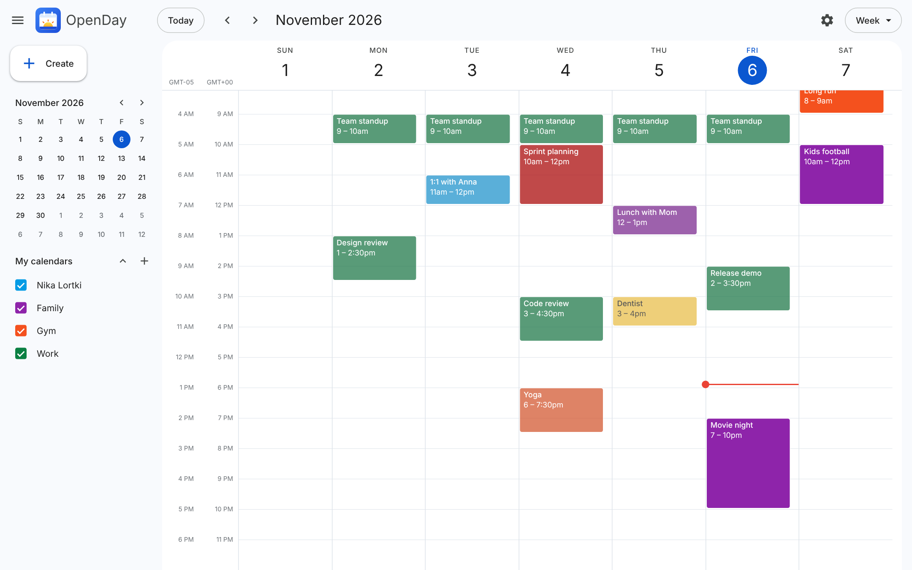
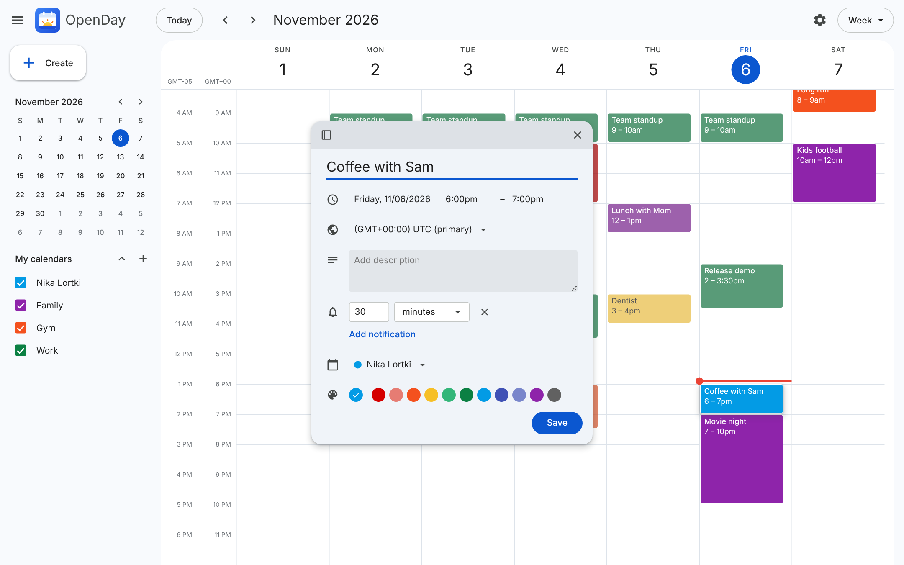
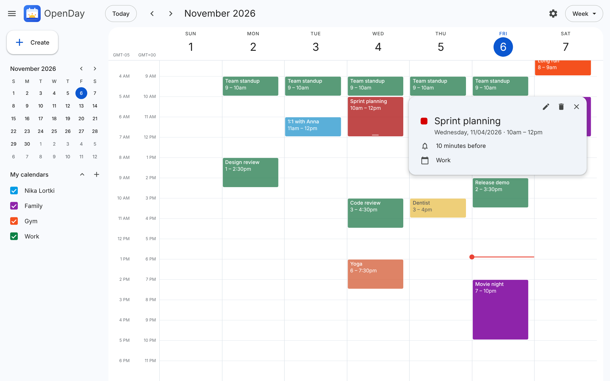
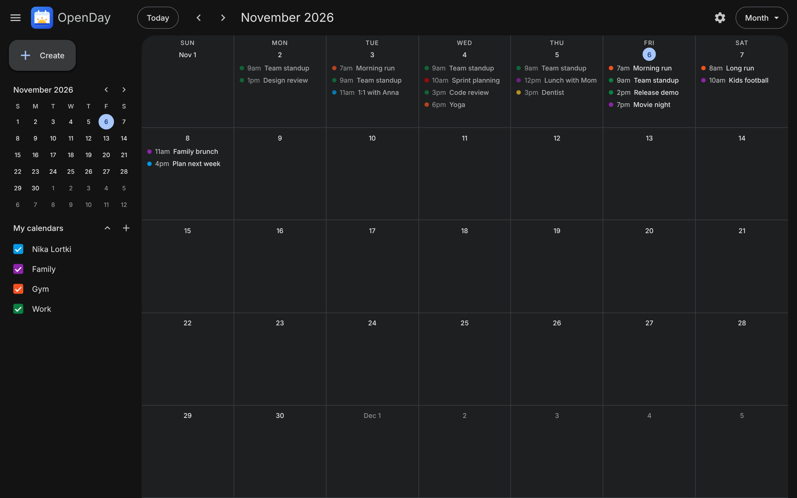
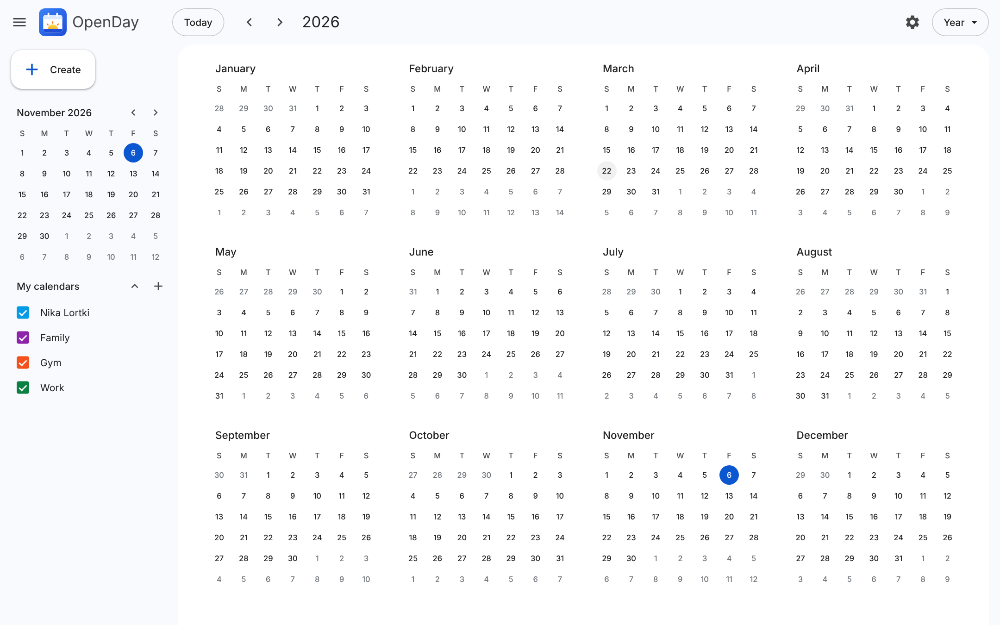
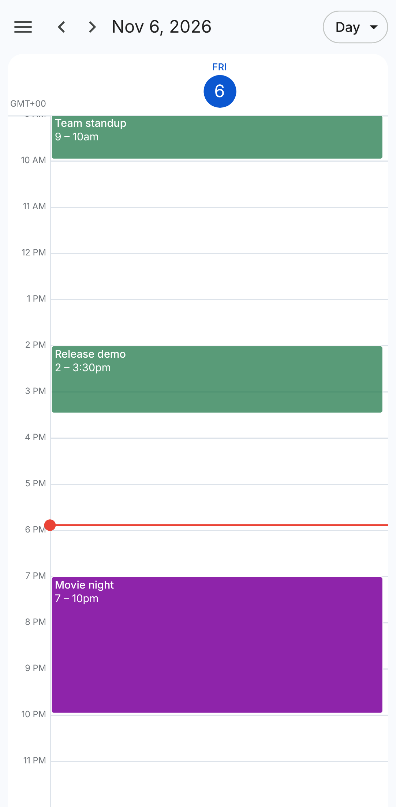

<p align="center">
  
</p>

<h1 align="center">lc2opencalendar</h1>
<h2 align="center">Fork of openday</h2>

<p align="center">
  <b>A self-hosted calendar that looks and works like Google Calendar.</b><br>
  Open source. One Docker container. Your data, on your server.
</p>

<p align="center">
  <a href="LICENSE"></a>
  
  
  
  
</p>

<p align="center">
  <a href="#-quick-start">Quick start</a> ·
  <a href="#-features">Features</a> ·
  <a href="#%EF%B8%8F-desktop-app">Desktop app</a> ·
  <a href="#-screenshots">Screenshots</a> ·
  <a href="#-for-developers">For developers</a>
</p>

<p align="center">
  
</p>

> [!WARNING]
> lc2opencalendar is in early development. Many features are missing and things may change or break between updates.

## 📸 Screenshots

<table>
  <tr>
    <td width="50%"><br><p align="center"><b>Create events</b> — time, time zone, notifications, calendar, color</p></td>
    <td width="50%"><br><p align="center"><b>Event details</b> — edit or delete in one click</p></td>
  </tr>
  <tr>
    <td width="50%"><br><p align="center"><b>Month view</b> — with dark theme</p></td>
    <td width="50%"><br><p align="center"><b>Year view</b> — the whole year at a glance</p></td>
  </tr>
</table>

<p align="center">
  <br>
  <b>Works on phones</b> — tap, long-press, swipe
</p>


## 🚀 Quick start

You need [Docker](https://docs.docker.com/get-docker/).

```bash
git clone https://github.com/lortkipa/lc2opencalendar.git
cd lc2opencalendar
docker build -t lc2opencalendar .
docker run -d --name lc2opencalendar -p 10085:10085 -v lc2opencalendar-data:/data --restart unless-stopped lc2opencalendar
```

Open **http://localhost:10085**.

Your events are saved in the `lc2opencalendar-data` volume.

## 🧰 Commands

| What | Command |
| --- | --- |
| Stop | `docker stop lc2opencalendar` |
| Start again | `docker start lc2opencalendar` |
| See logs | `docker logs lc2opencalendar` |
| Delete the app (keeps your data) | `docker rm -f lc2opencalendar` |
| Delete your data too | `docker volume rm lc2opencalendar-data` |

## 🔄 Update

```bash
git pull
docker build -t lc2opencalendar .
docker rm -f lc2opencalendar
docker run -d --name lc2opencalendar -p 10085:10085 -v lc2opencalendar-data:/data --restart unless-stopped lc2opencalendar
```

Your data stays in the volume.

## ✨ Features

- Day, week, month and year views.
- Click the calendar to add an event. Drag to pick a time range.
- Drag events to move them. Drag the bottom edge to resize.
- Events have a title, description and color. Events can overlap.
- Right-click an event to change its color or delete it.
- Several calendars (for example "Work" and "Family"), each with its own name and color. Tick them in the sidebar to show or hide their events. Create, rename, recolor and delete calendars in Settings.
- The event form can float or be docked to the side. On phones it slides up from the bottom.
- Notifications: each event can have up to 5 reminders ("30 minutes before"). Set any number of minutes, hours, days or weeks (up to 4 weeks). Shown as desktop notifications (with Snooze) or as alerts in the page, with an optional sound. The calendar must be open in a browser tab, or the [desktop app](#%EF%B8%8F-desktop-app) must be running.
- Live sync: a change in one browser tab, another computer or the desktop app shows everywhere else right away (no reload).
- Settings: date format, time format, time zone, default event length, default notification, notification settings.
- Several time zones: add up to 5 other time zones in Settings. They show as extra hour columns in the day and week views, and you can set an event's time zone to any of them.
- Light, dark or device theme.
- Works on phones: tap to add or open, hold an event to drag it or open its menu, swipe to change the day/week/month.
- Keyboard shortcuts: `D` `W` `M` `Y` (views), `T` (today), `J`/`K` (next/previous), `C` (create).

## 🖥️ Desktop app

The desktop app (Linux, Windows, macOS) shows your lc2opencalendar server in its own window. It is a client only; the server must be running and serve the built frontend.

- Closing the window keeps the app running in the tray, so **notifications still show**.
- Tray menu: Open, Reload, Change server, Start at login, Quit.
- It has no data of its own. Everything is on your server, so it stays in sync with the web app.

Build it (needs Node.js):

```bash
cd desktop && npm install && npm run dist
```

The installer is in `desktop/dist` (AppImage on Linux, `.exe` on Windows, `.dmg` on macOS). Build each one on its own system.
On the first start, enter your server address (for example `http://localhost:10085`).
For a local server, start the `backend.exe` (or `backend` on other platforms) from the release bundle, or run the Docker image, before connecting. The desktop app checks that the server includes the frontend and explains how to rebuild it if it does not.

Notes:

- Linux AppImages need FUSE 2 (Fedora: `sudo dnf install fuse-libs`, Ubuntu: `sudo apt install libfuse2`).
- The Snooze button works on Windows and macOS. On Linux it depends on your desktop (GNOME and KDE show it).
- If the calendar is also open in a browser, both can show the same reminder.

## 📦 Build a release

With Node.js, Go, and Docker installed and Docker running, run:

```bash
node build-release.mjs
```

The script builds the frontend into the backend binary, runs backend tests,
builds the desktop installer for the current OS, and builds and exports the
Docker image. It collects the backend binary and configuration, desktop
installer, Docker image archive, license, and README in a new platform-specific
folder under `release/`.
Build each desktop installer on its target OS.

## 🛠️ For developers

Run the backend (Go) and the frontend (Vite) in two terminals:

```bash
cd backend && go run .
```

```bash
cd frontend && npm install && npm run dev
```

Open http://localhost:5173. Run the backend tests with `cd backend && go test ./...`.

To build a standalone backend binary with the frontend embedded, run:

```bash
cd frontend && npm install && npm run build:app
```

The binary is written to `backend/backend.exe` on Windows or `backend/backend` on other platforms.
The backend reads `backend.config.json` from its working directory. Set `port`
and `database` there. Command-line `-port` and `-database` (or `-db`) options
override environment variables, which override the config file and defaults.

Desktop app in development (with the backend running): `cd desktop && npm install && npm start`.

AI coding agents should read [`AGENTS.md`](AGENTS.md) first.

## 📄 License

[MIT](LICENSE)
